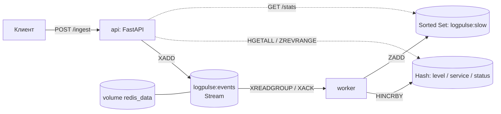

# LogPulse

Приём, проверка и статистика журналов сервисов **auth / orders / payment**.
HTTP API (FastAPI) принимает строки журнала, проверяет их регулярными выражениями,
кладёт корректные события в **Redis Stream**; отдельный **worker** обрабатывает события
и обновляет статистику в Redis.

## Архитектура



Редактируемая схема: `architecture.drawio` (открывается на https://app.diagrams.net/).

## Компоненты

| Компонент | Файл | Назначение |
|---|---|---|
| Парсер | `logpulse/parser.py` | одна маска `LINE_RE` + проверка полей, 4 доп. регулярных выражения |
| Очередь и статистика | `logpulse/store.py` | XADD, идемпотентное обновление счётчиков, чтение статистики |
| Worker | `logpulse/worker.py` | XREADGROUP → обработка → XACK, восстановление после сбоя Redis |
| API | `logpulse/routers.py`, `main.py`, `errors.py`, `deps.py`, `models.py` | APIRouter, Pydantic, единый формат ошибок |
| Docker | `Dockerfile`, `compose.yaml`, `.env.example` | сервисы api, worker, redis |

Структуры Redis: `logpulse:events` (Stream), `logpulse:stats:level|service|status` (Hash),
`logpulse:slow` (Sorted Set, score = duration_ms, member = rid), а также
`logpulse:stats:accepted|processed` (String) и `logpulse:seen` (Set, идемпотентность).
Порог медленного запроса: `duration_ms >= 500`.

## Запуск

```bash
cp .env.example .env            # необязательно: значения по умолчанию уже есть
docker compose up --build -d
docker compose ps
docker compose logs --tail=50 api worker redis
python tools/load_sample.py     # загрузка data/sample.log (или: docker compose exec api python tools/load_sample.py)
```

API доступен только на `127.0.0.1:8000`; порт Redis наружу не публикуется.
Swagger UI: <http://127.0.0.1:8000/docs>, схема: <http://127.0.0.1:8000/openapi.json>.

## Тестирование

```bash
docker compose exec api pytest -q          # в контейнере
pip install -r requirements.txt && pytest -q   # локально
TEST_REDIS_URL=redis://localhost:6379/15 pytest -q   # + тест с реальным Redis (БД 15, очищается)
```

Тесты используют in-memory `FakeRedis` и переопределение `Depends(get_redis)`,
рабочие данные не затрагиваются.

## Примеры запросов

```bash
curl -s http://127.0.0.1:8000/health
curl -s -X POST http://127.0.0.1:8000/ingest -H 'Content-Type: application/json' -d '{"lines": [
 "2026-10-20T12:34:56Z INFO auth 192.0.2.10 POST /api/login 200 43ms rid=ab12cd34",
 "2026-10-20T12:34:58Z ERROR orders 198.51.100.8 GET /api/orders 503 742ms rid=ee44cc22",
 "2026-10-20T12:35:02Z INFO auth 192.0.2.999 GET /api/me 200 12ms rid=aa11bb22"]}'
# {"accepted":2,"rejected":1,"errors":[{"line_no":3,"reason":"некорректный IPv4-адрес: 192.0.2.999","line":"..."}]}
curl -s http://127.0.0.1:8000/stats
curl -s 'http://127.0.0.1:8000/events?limit=5'
```

Ошибки имеют единый формат: `{"error": {"code": "...", "message": "...", "details": [...]}}`
(422 — `validation_error`, 503 — `redis_unavailable`, 500 — `internal_error`).

## Pydantic-модели (`logpulse/models.py`)

`IngestRequest` (`lines`: 1–100 строк по 1–500 символов), `IngestResponse` / `IngestError`,
`StatsResponse` / `SlowRequest`, `EventsResponse` / `EventOut`, `HealthResponse`,
`ErrorResponse` / `ErrorBody` / `ErrorDetail`.

## Эксплуатационный сценарий (restart Redis)

```bash
python tools/load_sample.py && curl -s 127.0.0.1:8000/stats
docker compose restart redis
curl -s -i 127.0.0.1:8000/health      # во время простоя: 503
sleep 10; curl -s 127.0.0.1:8000/health && curl -s 127.0.0.1:8000/stats
docker compose logs --tail=50 worker
```

Не используйте `docker compose down -v` для проверки сохранности данных — она удаляет volume.

## Известные ограничения

- **«Принято» ≠ «обработано»**: `accepted_total` растёт при XADD, `processed_total` — после обработки worker; разница — `in_queue`.
- Доставка «минимум один раз»: при падении между обновлением статистики и XACK сообщение придёт повторно.
  Дубли статистики исключены идемпотентностью по `rid` (`logpulse:seen`), поэтому повторно присланный
  rid тоже не учитывается. Два worker, одновременно получившие один и тот же rid, теоретически могут
  учесть его дважды (гонка между SISMEMBER и MULTI/EXEC).
- `logpulse:seen` и Stream не очищаются (нет trimming/TTL) — для долгой эксплуатации нужна политика хранения.
- Сообщения «мёртвых» consumer (другое `WORKER_NAME`) не перехватываются (нет XAUTOCLAIM).
- Redis без пароля: он доступен только внутри сети Compose.
